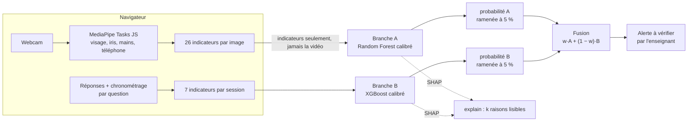

# ExamGuard AI — Documentation technique du module ML

> Public : développeurs de l'API FastAPI et du front Next.js, encadrant, jury.
> Ce document explique **comment** le module a été construit : étapes, code, modèles, sources de données et
> variables. Les chiffres à jour sont toujours dans [`reports/RAPPORT_ML.md`](../reports/RAPPORT_ML.md), régénéré
> automatiquement ; ceux cités ici proviennent de la dernière exécution (graine 42, résultats déterministes).

## Sommaire

1. [Vue d'ensemble](#1-vue-densemble)
2. [Sources des datasets](#2-sources-des-datasets)
3. [Les étapes (phases 0 à 8)](#3-les-étapes-phases-0-à-8)
4. [Le code](#4-le-code)
5. [Les modèles : comment ils sont construits](#5-les-modèles--comment-ils-sont-construits)
6. [Les variables (features) choisies](#6-les-variables-features-choisies)
7. [Fusion des deux branches](#7-fusion-des-deux-branches)
8. [Explicabilité (SHAP)](#8-explicabilité-shap)
9. [Contrat d'interface pour l'API](#9-contrat-dinterface-pour-lapi)
10. [Tests](#10-tests)
11. [Reproduire de zéro](#11-reproduire-de-zéro)
12. [Limites à connaître](#12-limites-à-connaître)
13. [Références](#13-références)

---

## 1. Vue d'ensemble

ExamGuard AI signale à un enseignant des comportements **à vérifier** pendant un examen en ligne. Le module ML a
deux branches entraînées séparément (aucun jeu public ne contient les deux types de signaux pour les mêmes
sessions), une fusion, et une explication de chaque score.



| Élément | Choix | Fichier produit |
|---|---|---|
| Branche B (session d'examen) | XGBoost + calibration de Platt | `artifacts/browser_model.joblib` |
| Branche A (webcam, une image) | Random Forest + calibration de Platt | `artifacts/webcam_model.joblib` |
| Fusion | moyenne pondérée, w_webcam = 0,60 | `artifacts/fusion_config.json` |
| Identité par la frappe (option) | Manhattan mis à l'échelle / Mahalanobis | pas de modèle sauvegardé (hors fusion) |
| Explications | SHAP (TreeExplainer) | calculées à la demande |

Environnement : Python 3.11, CPU uniquement, scikit-learn 1.9.1, xgboost 3.2.0, shap 0.51.0, pandas 3.0.6,
numpy 2.4.6, pydantic 2.13.5 (versions figées dans [`requirements.txt`](../requirements.txt)).

---

## 2. Sources des datasets

| | Branche B | Branche A | Option identité |
|---|---|---|---|
| Nom | `online_exam_data.csv` | *Students suspicious behaviors detection dataset for AI-powered online exam proctoring* | CMU Keystroke Dynamics Benchmark (`DSL-StrongPasswordData.csv`) |
| Auteurs / origine | fourni par l'équipe | M. K. Hossen & M. S. Uddin (CUET, Jahangirnagar University), Mendeley Data v1, 8 juillet 2025 | K. S. Killourhy & R. A. Maxion, Carnegie Mellon University, DSN 2009 |
| Identifiant | — | DOI [10.17632/39xs8th543.1](https://data.mendeley.com/datasets/39xs8th543/1) | page du benchmark CMU |
| Licence | **non documentée** (à clarifier avant publication) | **CC BY 4.0** (attribution obligatoire ; nos variables dérivées = modification) | données de recherche, citer l'article |
| Obtention | copie manuelle dans `data/raw/` | téléchargement automatique par l'API publique Mendeley (`python -m examguard_ml.data --download`) | copie manuelle dans `data/raw/` |
| SHA-256 | `7043dc7d…f5b1` | `840e3bce…3325` | `b11d2353…7a33` |
| Taille | 1 600 sessions, 13 colonnes | 5 500 images, 38 colonnes (76 doublons retirés → 5 424) | 20 400 saisies, 51 sujets × 400 |
| Étiquette | `prediction` : Cheating 77 (4,8 %) / Genuine 1 523 | `label` : triche 2 619 (47,6 %) / normal 2 881 | aucune étiquette de triche |
| Identifiant participant | `student_name` unique → 1 ligne = 1 participant | **aucun** | `subject` |

Jeux **écartés** : *Students' Abnormal Behavior in Online Exam* (Harvard Dataverse, DOI 10.7910/DVN/WUWRAB, images ;
non téléchargé, licence à vérifier) et Kamalov et al. (PLOS ONE 2021 ; ce sont des notes, pas de la télémétrie).

Les empreintes SHA-256 complètes sont dans [`src/examguard_ml/config.py`](../src/examguard_ml/config.py) et vérifiées
par `python -m examguard_ml.data --check`. **Aucun dataset n'est versionné dans Git** (`.gitignore`).

### Ce que l'audit a révélé (Phase 1)
- `online_exam_data.csv` ne contient **aucune** télémétrie navigateur (onglets, copier-coller, souris, frappe),
  contrairement au cahier des charges : seulement des compteurs de réponses et une durée. Les noms ressemblent à des
  noms générés : jeu probablement synthétique (non vérifié).
- Les **77 tricheurs ont tous réussi** l'examen (0 parmi les échecs) → biais « bonne note = suspect ».
- Jeu Mendeley : lignes = images successives de vidéos (distance médiane 18,4 px entre lignes voisines contre
  119,3 px au hasard) ; 98,9 % des lignes « triche » ont une anomalie de détecteur contre 0 % des lignes normales
  → l'étiquette est en grande partie une règle sur les sorties des détecteurs.

Détails : [`reports/audit_browser.md`](../reports/audit_browser.md), [`audit_webcam.md`](../reports/audit_webcam.md),
[`audit_keystroke.md`](../reports/audit_keystroke.md).

---

## 3. Les étapes (phases 0 à 8)

Chaque phase a un critère de fin et un commit Git dédié.

| Phase | Ce qui a été fait | Critère de fin atteint | Commande |
|---|---|---|---|
| 0 — Setup | structure `ml/`, `environment.yml`, `requirements.txt`, `pyproject.toml`, README ; environnement recréé de zéro | `pytest` passe sur un environnement neuf | `conda env create -f environment.yml` |
| 1 — Audit | schéma, types, manquants, doublons, équilibre, identifiants, risques de fuite, **audit de parité** navigateur | `reports/audit_*.md` | `python -m examguard_ml.audit` |
| 2 — Branche B | régression logistique, Random Forest, XGBoost, MLP ; déséquilibre ; calibration ; ablations B2/B3 | tableau comparatif + modèle sauvegardé | `python -m examguard_ml.train browser` |
| 3 — Branche A | même démarche sur variables reproductibles ; découpage par blocs ; mesure de la fuite ; modèle de référence | idem | `python -m examguard_ml.train webcam` |
| 4 — CMU | réimplémentation propre du protocole Killourhy & Maxion | EER publiés reproduits (0,0962 / 0,1101) | `python -m examguard_ml.keystroke` |
| 5 — Fusion | correction de prévalence, moyenne pondérée, poids choisi sur paires **simulées**, ablation A / B / fusion | `reports/fusion.md` + `fusion_config.json` | `python -m examguard_ml.fusion` |
| 6 — SHAP | importance globale, explications locales, `explain()` JSON | figures + exemples réels | `python -m examguard_ml.explain` |
| 7 — Tests | 78 tests pytest, corrigés jusqu'au vert | 78/78 | `pytest` |
| 8 — Emballage | `inference.py`, schémas pydantic, fiche modèle, commande unique, page de test | modèles dans `artifacts/` | `python -m examguard_ml.pipeline` |

Décision ajoutée après coup (validée par l'équipe) : **« temps idéal » = 3 min (180 s cumulées) par question**,
codée dans `features.IDEAL_SECONDS_PER_QUESTION` et `build_browser_features()`.
Mise à jour (25/11/2026, validée par l'équipe) : la simulation de cohortes (`reports/ideal_time.md`) montre 63 % de
fausses alertes avec 180 s fixes pour un rythme honnête de 75 s par question, contre 9 % avec un temps idéal
**adaptatif** (médiane des temps de réponse de l'examen), la triche restant détectée à 100 %. L'application utilise
donc le mode adaptatif par défaut (`EXAMGUARD_IDEAL_TIME_MODE=fixed` pour revenir à 180 s) et transmet la valeur au
service (`ideal_seconds`) ; 180 s reste la valeur par défaut du module ML lui-même.

---

## 4. Le code

```
ml/
├── environment.yml / requirements.txt / pyproject.toml
├── inference.py                 ← contrat d'interface appelé par l'API
├── MODEL_CARD.md                ← fiche modèle
├── docs/DOCUMENTATION_TECHNIQUE.md
├── data/raw, data/processed     ← données (ignorées par Git)
├── notebooks/01_exploration.ipynb
├── scripts/demo_server.py + demo_page.html   ← page de test locale (webcam en direct)
├── src/examguard_ml/
│   ├── config.py      chemins, graine (42), SHA-256, set_seed()
│   ├── data.py        téléchargement Mendeley, vérification, chargement, nettoyage, contrats bruts
│   ├── features.py    construction des variables (identique entraînement / inférence), libellés FR
│   ├── audit.py       Phase 1
│   ├── metrics.py     PR-AUC, F1, rappel@précision, seuil F1-max, bootstrap
│   ├── modeling.py    estimateurs équilibrés, grilles, validation croisée parallèle, calibration
│   ├── train.py       Phases 2-3 : découpages, sélection, sauvegarde, expériences de fuite
│   ├── keystroke.py   Phase 4
│   ├── fusion.py      Phase 5 : adjust_prior, fuse, simulation
│   ├── explain.py     Phase 6 : SHAP
│   ├── schemas.py     schémas pydantic d'entrée / sortie
│   ├── report.py      RAPPORT_ML.md + MODEL_CARD.md (chiffres lus dans les JSON)
│   ├── pipeline.py    commande unique
│   └── utils.py       tableaux Markdown, JSON, versions
├── tests/             78 tests pytest
├── artifacts/         modèles *.joblib + métadonnées *.json + fusion_config.json
└── reports/           audits, rapports, figures, résultats JSON
```

### Flux d'une prédiction

```
dict reçu par l'API
  → schemas.BrowserSessionFeatures / WebcamFrameFeatures   (validation : types, plages, cohérence)
  → bundle["model"]  = CalibratedPipeline
        base = Pipeline[ features (BrowserFeatures / WebcamFeatures)
                         → scaler (StandardScaler, seulement logreg / MLP)
                         → clf (XGBoost / Random Forest / …) ]
        calibrator = Platt ou isotonique
  → probabilité calibrée (prévalence d'entraînement)
  → fusion.adjust_prior → probabilité à 5 % de prévalence
  → explain : SHAP sur base.clf, valeurs lisibles prises après features (avant normalisation)
```

Principe clé : **les variables dérivées sont calculées dans le pipeline sérialisé**. L'API n'envoie que les
indicateurs bruts du contrat ; elle ne recalcule jamais de ratio, ce qui garantit la parité entraînement / inférence.

---

## 5. Les modèles : comment ils sont construits

### 5.1 Découpage (zéro fuite)

| | Branche B | Branche A |
|---|---|---|
| Unité de groupe | participant (`student_name`, 1 ligne = 1 participant) | **bloc de 100 lignes contiguës** (proxy de session, aucun identifiant) |
| Test | 25 % stratifié → 1 200 / 400 sessions (58 / 19 triches) | `StratifiedGroupKFold(5)`, 1er pli → 4 337 / 1 087 images |
| Validation croisée (sur l'apprentissage seulement) | `RepeatedStratifiedKFold` 5 plis × 3 répétitions = 15 plis | `StratifiedGroupKFold` 5 plis par blocs |
| Contrôle | 0 participant commun, 0 ligne identique | 0 bloc commun ; doublons exacts retirés **avant** découpage |

Le jeu de test n'intervient **jamais** dans le choix du modèle, des hyperparamètres, de la calibration ou du seuil.

### 5.2 Familles de modèles et grilles (volontairement petites : CPU, 16 Go)

| Famille | Implémentation | Grille | Déséquilibre |
|---|---|---|---|
| Régression logistique | `LogisticRegression(max_iter=5000)` + `StandardScaler` | C ∈ {0,01 ; 0,1 ; 1 ; 10} × class_weight ∈ {None, balanced} | `class_weight="balanced"` |
| Random Forest | `RandomForestClassifier(n_estimators=300)` | max_depth ∈ {None, 8} × min_samples_leaf ∈ {1, 5} × class_weight ∈ {None, balanced_subsample} | `balanced_subsample` |
| XGBoost | `BalancedXGB` (learning_rate 0,05, subsample 0,8, colsample 0,8, `hist`) | max_depth ∈ {2, 4} (B) ou {4, 6} (A) × n_estimators ∈ {200, 500} × balanced ∈ {non, oui} | `scale_pos_weight = n_neg / n_pos` calculé sur l'apprentissage |
| MLP (réseau de neurones) | `BalancedMLP` : `MLPClassifier` ReLU, Adam, lr 1e-3, 400 itérations + `StandardScaler` | couches ∈ {(32), (64, 32)} × alpha ∈ {1e-4 ; 1e-2 ; 1} | poids d'échantillons « balanced » |

`BalancedXGB` et `BalancedMLP` (dans `modeling.py`) sont de petits enveloppes compatibles scikit-learn qui calculent
la pondération à partir des seules données d'apprentissage du pli. TabNet / FT-Transformer n'ont pas été
entraînés (PyTorch requis, peu pertinent sur ces tailles de données).

### 5.3 Sélection, calibration, seuil

1. **Sélection des hyperparamètres** : pour chaque famille, la configuration de meilleure **PR-AUC moyenne** en
   validation croisée.
2. **Sélection de la famille** : meilleure PR-AUC CV ; si une autre est à moins de **0,005**, on préfère la plus
   simple (logreg < RF < XGBoost < MLP).
3. **Calibration** : sur les scores hors-échantillon (OOF) de la validation croisée, on compare Platt
   (régression logistique sur logit(score)) et isotonique par validation croisée 5 plis ; on garde le meilleur
   **score de Brier**. Le modèle de base est réentraîné sur tout l'apprentissage, le calibrateur est ajusté sur
   tous les scores OOF (`CalibratedPipeline`).
4. **Seuil d'alerte de branche** : seuil qui maximise le **F1** sur les probabilités calibrées OOF (jamais sur le test).
5. **Évaluation** : une seule fois sur le test — PR-AUC, F1, précision, rappel, rappel à précision ≥ 0,8 / 0,9,
   ROC-AUC, Brier, matrice de confusion, IC 95 % par bootstrap stratifié (1 000 tirages). L'*accuracy* n'est pas utilisée.

### 5.4 Résultats

**Branche B** (test : 400 sessions dont 19 triches)

| Modèle | PR-AUC CV | PR-AUC test | F1 test | Calibration | Paramètres retenus |
|---|---|---|---|---|---|
| Régression logistique | 0,804 ± 0,077 | 0,775 | 0,789 | Platt | C = 10, sans pondération |
| Random Forest | 0,837 ± 0,091 | 0,743 | 0,778 | isotonique | max_depth 8, min_samples_leaf 1 |
| **XGBoost (retenu)** | **0,847 ± 0,073** | **0,821** | 0,722 | Platt | max_depth 2, 200 arbres, sans pondération |
| MLP | 0,748 ± 0,092 | 0,702 | 0,645 | isotonique | (32), alpha 1 |

Seuil 0,597 ; IC 95 % PR-AUC [0,685 ; 0,953]. Ablations : sans « temps idéal » PR-AUC test 0,237, sans aucune
variable de correction 0,339.

**Branche A** (test : 1 087 images dont 505 triches)

| Modèle | PR-AUC CV | PR-AUC test | F1 test | Calibration | Paramètres retenus |
|---|---|---|---|---|---|
| Régression logistique | 0,811 ± 0,052 | 0,770 | 0,665 | isotonique | C = 0,01 |
| **Random Forest (retenu)** | **0,921 ± 0,010** | **0,934** | 0,847 | Platt | profondeur libre, min_samples_leaf 1 |
| XGBoost | 0,923 ± 0,012 | 0,938 | 0,844 | Platt | max_depth 6, 500 arbres, pondéré |
| MLP | 0,909 ± 0,017 | 0,908 | 0,823 | Platt | (64, 32), alpha 1 |

XGBoost est à 0,0013 du Random Forest en CV : la règle de départage retient le plus simple. Seuil 0,488 ;
IC 95 % PR-AUC [0,920 ; 0,947]. Sensibilité à la fuite temporelle (CV) : 0,960 en découpage aléatoire, 0,943 /
0,934 / 0,918 / 0,896 avec des blocs de 25 / 100 / 250 / 500 lignes. Modèle de référence (toutes les colonnes,
non déployable) : 0,9998, expliqué par la circularité de l'étiquette (une règle sans apprentissage atteint F1 0,999).

### 5.5 Ce que contient un fichier `*_model.joblib`

| Clé | Contenu |
|---|---|
| `model` | `CalibratedPipeline` (pipeline complet + calibrateur) |
| `threshold` | seuil d'alerte de la branche |
| `raw_columns` | colonnes brutes attendues en entrée (contrat) |
| `feature_names` | variables construites, dans l'ordre du modèle |
| `train_prior` | prévalence de l'apprentissage (0,048 pour B, 0,470 pour A) |
| `background` | 10 centroïdes k-means (fond SHAP pour modèles linéaires / MLP ; aucune ligne réelle stockée) |
| `metrics_test`, `metrics_cv`, `params`, `calibration`, `model_name`, `model_label` | traçabilité |
| `seed`, `versions`, `trained_at` | reproductibilité |

Une copie sans le modèle est écrite en JSON (`*_model.json`). Tailles : 0,03 Mo (B), 4,57 Mo (A).

---

## 6. Les variables (features) choisies

### 6.1 Branche B — session d'examen

**Entrée brute (contrat `BrowserSessionFeatures`, 7 champs)** : `exam_mode`, `tot_question`, `tot_que_attempted`,
`que_att_within_idl_time`, `idl_time_correct_que`, `tot_correct_que`, `exam_finish_time_in_sec`.

**Colonnes du fichier écartées**

| Colonne | Raison |
|---|---|
| `student_name` | identifiant personnel, jamais une variable |
| `questions_to_pass` | = 0,6 × tot_question pour 100 % des lignes (redondante) |
| `tot_exam_time` | = 3 × tot_question minutes pour 100 % des lignes (redondante) |
| `result` | dérivée de la note (pass ⇔ bonnes réponses ≥ seuil) |
| `finish_time_in_min` | = ⌊secondes / 60⌋ (redondante) |

**Variables du modèle (B1, 14 variables, `features.browser_features`)**

| Variable | Formule | Libellé enseignant |
|---|---|---|
| `remote` | 1 si exam_mode = remote | Examen passé à distance |
| `tot_question` | brut | Nombre de questions de l'examen |
| `tot_que_attempted` | brut | Nombre de questions répondues |
| `que_att_within_idl_time` | brut (≤ 180 s cumulées) | Questions répondues dans le temps idéal |
| `idl_time_correct_que` | brut | Bonnes réponses données dans le temps idéal |
| `tot_correct_que` | brut | Nombre de bonnes réponses |
| `exam_finish_time_in_sec` | brut | Durée de la session (s) |
| `frac_attempted` | répondues / questions | Part des questions répondues |
| `frac_correct` | bonnes / questions | Part de bonnes réponses |
| `acc_attempted` | bonnes / max(répondues, 1) | Taux de réussite sur les questions répondues |
| `frac_idl` | dans le temps idéal / max(répondues, 1) | Part des réponses dans le temps idéal |
| `idl_corr_rate` | justes rapides / max(rapides, 1) | Taux de réussite des réponses rapides |
| `frac_time_used` | durée / (questions × 180 s) | Part du temps alloué utilisée |
| `sec_per_attempt` | durée / max(répondues, 1) | Temps moyen par question répondue |

**Jeux d'ablation** : B2 « sans temps idéal » (retire les 4 variables liées au temps idéal), B3 « sans correction »
(retire toute variable de note). Ils servent à mesurer la dépendance du modèle, pas au déploiement.

**Convention « temps idéal »** : une question répondue compte si le temps **cumulé** passé dessus (toutes visites)
est ≤ 180 s, ou ≤ `ideal_seconds` quand l'application le fournit (mode adaptatif, défaut de l'application).
L'application doit utiliser `build_browser_features(exam_mode, tot_question, answers, session_seconds, ideal_seconds)`.

**Variables les plus influentes (SHAP global)** : part de bonnes réponses, bonnes réponses dans le temps idéal,
taux de réussite des réponses rapides, part des réponses dans le temps idéal, part des questions répondues.

### 6.2 Branche A — webcam (une image)

**Audit de parité** : seules les colonnes qu'on peut recalculer **à l'identique dans le navigateur** avec
MediaPipe Tasks JS sont gardées.

**Colonnes Mendeley exclues (11)**

| Colonne | Raison |
|---|---|
| `face_conf` | score propre au détecteur d'origine (0–100), non comparable |
| `phone_conf` | score propre à YOLOv5/v7 |
| `hand_obj_interaction` | règle « main-objet » maison non documentée |
| `head_pose` | catégorie issue de seuils non documentés |
| `head_pitch`, `head_yaw`, `head_roll` | unité non conforme à la doc (« degrés » mais ≈ 0,01) |
| `gaze_on_script`, `gaze_direction` | zone « script » et modèle de regard non documentés |
| `gazePoint_x`, `gazePoint_y` | point de regard du modèle maison |

**Entrée brute retenue (contrat `WebcamFrameFeatures`, 26 champs)** — repère image **640 × 480 px**, mains en
coordonnées normalisées 0–1, **0 si non détecté** :

| Groupe | Champs | Équivalent MediaPipe (navigateur) |
|---|---|---|
| Visage | `face_present`, `no_of_face`, `face_x`, `face_y`, `face_w`, `face_h` | Face Detector (BlazeFace) : nombre et boîte englobante |
| Points du visage | `left_eye_*`, `right_eye_*`, `nose_tip_*`, `mouth_*` | 6 points clés du Face Detector ; « gauche » = le plus à gauche dans l'image |
| Mains | `hand_count`, `left_hand_*`, `right_hand_*` | HandLandmarker : poignet (repère 0), latéralité MediaPipe |
| Téléphone | `phone_present`, `phone_loc_x`, `phone_loc_y` | ObjectDetector EfficientDet-Lite0, classe COCO « cell phone », centre de la boîte |
| Pupilles | `pupil_left_*`, `pupil_right_*` | FaceLandmarker, iris 468 et 473 |

**Variables du modèle (22, `features.webcam_features`)** — invariantes à la position et à l'échelle quand c'est
possible ; mises à 0 (ou √2 pour les distances) si l'élément n'est pas détecté :

| Variable | Formule |
|---|---|
| `face_present`, `no_of_face` | bruts |
| `face_size` | face_w / 640 (proximité de la caméra) |
| `face_cx`, `face_cy` | centre de la boîte / (640, 480) |
| `eye_dist_ratio` | distance inter-yeux / face_w (rotation de la tête) |
| `yaw_proxy` | (nez_x − milieu des yeux_x) / distance inter-yeux |
| `pitch_proxy` | (nez_y − milieu des yeux_y) / distance inter-yeux |
| `roll_proxy` | atan2(œil droit_y − œil gauche_y, œil droit_x − œil gauche_x) |
| `mouth_nose_ratio` | (bouche_y − nez_y) / distance inter-yeux |
| `hand_count`, `left_hand_x/y`, `right_hand_x/y` | bruts |
| `hand_face_dist` | distance minimale poignet–centre du visage (√2 si aucune main) |
| `phone_present`, `phone_x`, `phone_y` | présence ; position / (640, 480) |
| `pupils_detected` | 1 si les deux pupilles sont détectées |
| `pupil_dx`, `pupil_dy` | décalage moyen pupille − centre de l'œil / distance inter-yeux (direction du regard) |

**Variables les plus influentes (SHAP global)** : taille du visage, téléphone détecté, position verticale du
téléphone, distance bouche-nez, position verticale du visage.

### 6.3 CMU Keystroke (option)

31 variables temporelles (11 durées d'appui H, 10 intervalles appui-appui DD, 10 intervalles relâché-appui UD) sur
le mot de passe fixe `.tie5Roanl`. DD = H + UD exactement → covariance singulière, d'où la pseudo-inverse.

---

## 7. Fusion des deux branches

1. **Correction de prévalence** (`fusion.adjust_prior`) — chaque probabilité calibrée est ramenée à la prévalence
   de déploiement supposée **π = 5 %** :
   `cote' = p/(1−p) × [π/(1−π)] / [π_train/(1−π_train)]`, puis `p' = cote'/(1+cote')`.
   Indispensable : A est calibrée sur 47,0 % de triche, B sur 4,8 %.
2. **Moyenne pondérée** (`fusion.fuse`) : `score = w · p'_webcam + (1 − w) · p'_navigateur`.
3. **Choix de w** sur une grille 0 → 1 (pas 0,05), en maximisant la PR-AUC moyenne sur 50 simulations de paires
   construites à partir des prédictions **hors-échantillon de l'apprentissage**.
4. **Évaluation** sur 200 simulations de 2 000 paires construites à partir des **jeux de test**, deux scénarios :
   concordant (triche visible dans les deux) et partiel (1/3 les deux, 1/3 webcam seule, 1/3 navigateur seul).
5. **Configuration exportée** (scénario partiel) : w_webcam = 0,60, seuil d'alerte = 0,256.

⚠ **Paires simulées** (aucun jeu commun) : illustration du mécanisme, à ré-estimer sur le pilote. Côté application,
le score webcam d'une session doit être une **agrégation sur une fenêtre de temps** (`predict_webcam_session`),
jamais une image isolée.

---

## 8. Explicabilité (SHAP)

| Modèle | Explicateur | Unité des contributions |
|---|---|---|
| XGBoost (B) | `shap.TreeExplainer` | log-odds, avant calibration |
| Random Forest (A) | `shap.TreeExplainer` | probabilité (votes), avant calibration |
| Régression logistique | `shap.LinearExplainer` (fond : 10 centroïdes) | log-odds |
| MLP | `shap.KernelExplainer` (fond : 10 centroïdes, 200 échantillons) | probabilité |

La calibration est monotone : le **sens** des contributions est conservé. L'additivité est testée
(valeur de base + somme des contributions = sortie brute du modèle). Sortie de `explain()` :

```json
{
  "branche": "navigateur / session d'examen",
  "probabilite": 0.9744, "seuil": 0.59656, "alerte": true,
  "valeur_de_base": -3.02075, "unite_contribution": "log-odds (XGBoost, avant calibration)",
  "contributions": [
    {"variable": "frac_idl", "libelle": "Part des réponses données dans le temps idéal",
     "valeur": 0.9474, "contribution": 1.50944, "direction": "augmente le risque",
     "texte": "Part des réponses données dans le temps idéal = 0.9474 → augmente le risque"}
  ],
  "avertissement": "Un score n'est pas une preuve : il signale un comportement à vérifier. L'enseignant décide et l'étudiant peut contester."
}
```

---

## 9. Contrat d'interface pour l'API

```python
from inference import (build_browser_features, predict_browser, predict_webcam,
                       predict_webcam_session, fuse, explain)
```

| Fonction | Entrée | Sortie |
|---|---|---|
| `build_browser_features(exam_mode, tot_question, answers, session_seconds)` | `answers` = une entrée par question répondue `{"seconds", "correct"}` | dict validé de 7 champs |
| `predict_browser(features)` | dict `BrowserSessionFeatures` | `BranchPrediction` |
| `predict_webcam(features)` | dict `WebcamFrameFeatures` (une image) | `BranchPrediction` |
| `predict_webcam_session(frames)` | liste d'images | moyenne / max des probabilités à 5 %, part d'images en alerte |
| `fuse(sa, sb, w=None)` | probabilités **à 5 %** (`probabilite_deploiement`) | `FusionResult` (score, poids, seuil, alerte) |
| `explain(branch, features, k=5)` | `"browser"` ou `"webcam"` | `Explanation` (k contributions) |

`BranchPrediction` : `probabilite` (prévalence d'entraînement), `probabilite_deploiement` (5 %), `seuil`, `alerte`,
`modele`, `version`, `hors_domaine` (avertissements si la valeur est valide mais jamais vue à l'entraînement).

**Validation** (pydantic, `extra="forbid"`, NaN/inf refusés) — lève `pydantic.ValidationError`, à traduire en HTTP 422 :
champ manquant, type faux, hors plage physique, champ inconnu, incohérence (ex. plus de bonnes réponses que de
réponses, `face_present = 1` avec `no_of_face = 0`).

Latence médiane mesurée (CPU, une observation) : `predict_browser` 6,5 ms, `predict_webcam` 32,5 ms,
`explain` 18 ms (B) et 120 ms (A).

---

## 10. Tests

78 tests, tous verts (`pytest`, ≈ 15 s).

| Fichier | Tests | Vérifie |
|---|---|---|
| `test_smoke.py` | 2 | import du paquet, structure des dossiers |
| `test_schema.py` | 9 (+ paramétrés) | entrées valides acceptées ; manquantes, NaN, hors plage, incohérentes, champs inconnus refusées ; **toutes** les lignes d'entraînement acceptées |
| `test_data_features.py` | 7 | tailles des jeux, colonnes exclues, formules, invariance par translation, cas « aucun visage » |
| `test_leakage.py` | 6 | groupes disjoints, découpages reproductibles, scaler ajusté sur l'apprentissage seulement, seuil choisi hors test |
| `test_determinism.py` | 3 | même graine = mêmes prédictions (branche complète), graine différente = modèle différent |
| `test_models.py` | 8 (+ paramétrés) | taille < 25 Mo, latence, prédictions sauvegardées reproduites, mieux que le hasard, stabilité aux petites perturbations |
| `test_inference.py` | 9 | contrat `inference.py`, `fuse`, `adjust_prior`, simulation, `explain`, additivité SHAP, erreurs |
| `test_keystroke.py` | 6 | EER sur cas connus, protocole 200/200/250, EER publiés reproduits |
| `test_ideal_time.py` | 5 | règle des 180 s (180 compte, 181 non), `build_browser_features` |

---

## 11. Reproduire de zéro

```bash
conda env create -f environment.yml
conda activate examguard-ml
pip install -e .                                 # ou : set PYTHONPATH=src
python -m examguard_ml.data --download           # jeu Mendeley ; copier les deux autres CSV dans data/raw/
python -m examguard_ml.data --check
python -m examguard_ml.pipeline                  # ≈ 6-7 min sur CPU : audit → B → A → CMU → fusion → SHAP → rapport
pytest --junitxml=reports/pytest_junit.xml
python -m examguard_ml.report                    # intègre le résultat des tests au rapport
python scripts/demo_server.py                    # page de test : http://localhost:8765 (Chrome / Edge pour la webcam)
```

Toutes les graines sont fixées (42) : deux exécutions donnent des résultats identiques.

---

## 12. Limites à connaître

- **B** : aucune télémétrie navigateur réelle ; étiquette liée à la réussite (risque de faux positifs sur les bons
  étudiants) ; 19 positifs en test seulement ; définition d'origine du « temps idéal » inconnue.
- **A** : données de laboratoire ; aucun identifiant de participant (fuite résiduelle possible malgré les blocs) ;
  étiquette en grande partie dérivée des détecteurs ; convention miroir inconnue ; taux de faux positifs de 10,8 %
  par image (≈ 0,29 de précision attendue à 5 % de prévalence) → agréger dans le temps.
- **Fusion** : validée seulement sur paires simulées.
- **Événements navigateur** (onglets, copier-coller, focus) : pas de données étiquetées → règles affichées en
  attendant le pilote.

Détails, chiffres et figures : [`reports/RAPPORT_ML.md`](../reports/RAPPORT_ML.md), [`MODEL_CARD.md`](../MODEL_CARD.md).

---

## 13. Références

- Hossen, M. K., & Uddin, M. S. (2025). *Students suspicious behaviors detection dataset for AI-powered online exam
  proctoring* (v1). Mendeley Data. https://doi.org/10.17632/39xs8th543.1 — CC BY 4.0.
- Killourhy, K. S., & Maxion, R. A. (2009). Comparing anomaly-detection algorithms for keystroke dynamics.
  *IEEE/IFIP International Conference on Dependable Systems and Networks (DSN 2009)*.
- Lundberg, S. M., & Lee, S.-I. (2017). A unified approach to interpreting model predictions. *NeurIPS 2017* (SHAP).
- Chen, T., & Guestrin, C. (2016). XGBoost: A scalable tree boosting system. *KDD 2016*.
- Breiman, L. (2001). Random forests. *Machine Learning*, 45(1).
- Platt, J. (1999). Probabilistic outputs for support vector machines. *Advances in Large Margin Classifiers*.
- Google. MediaPipe Tasks Vision (Face Detector, Face Landmarker, Hand Landmarker, Object Detector), v0.10.14.
