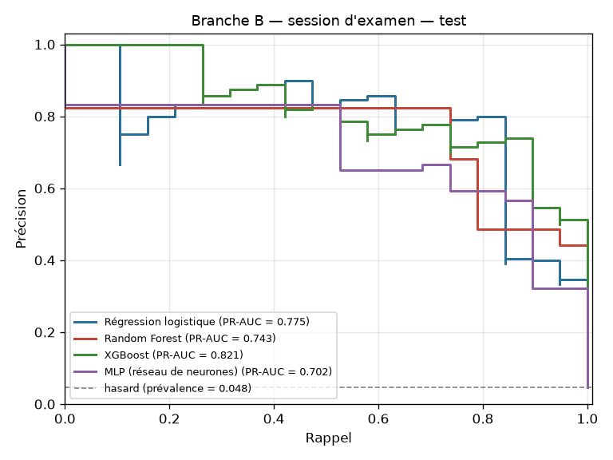
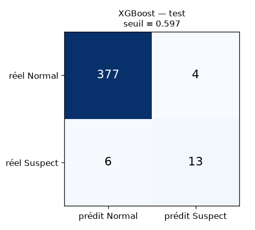
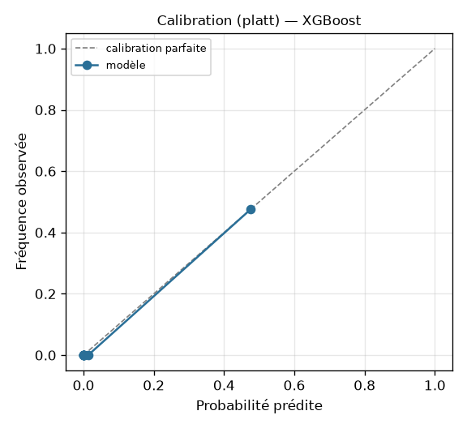
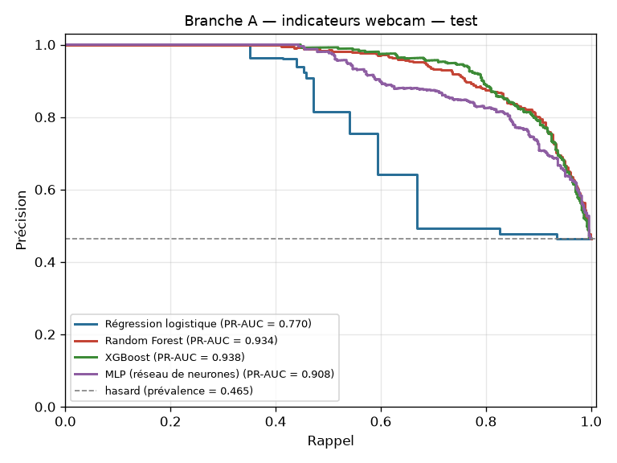
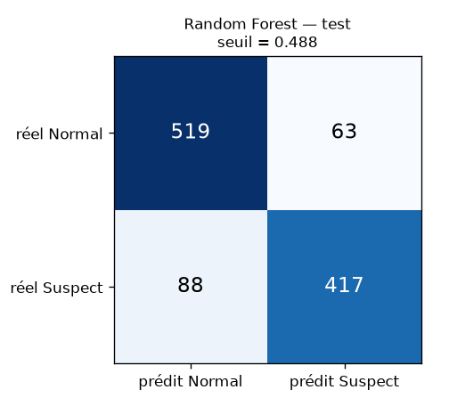
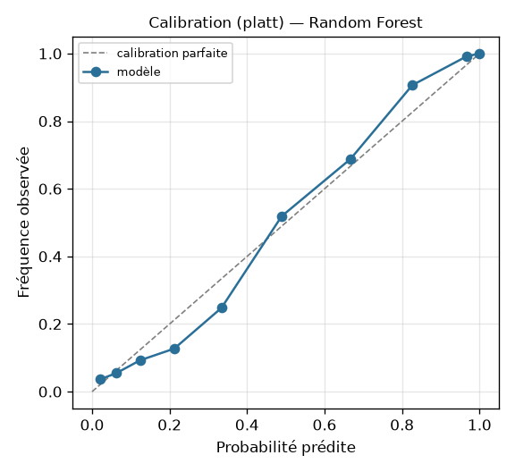
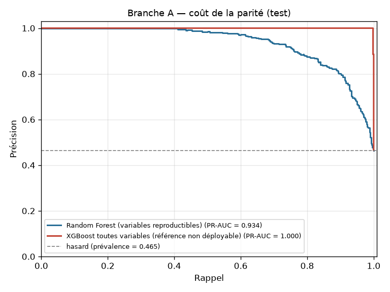
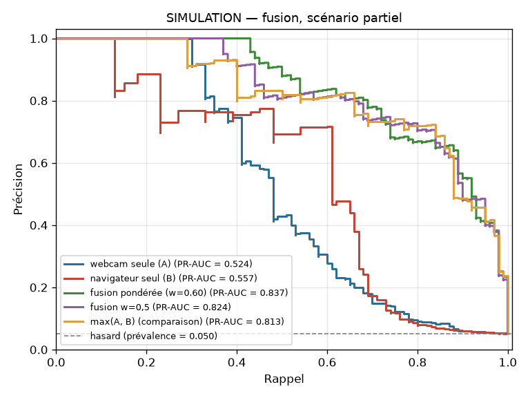
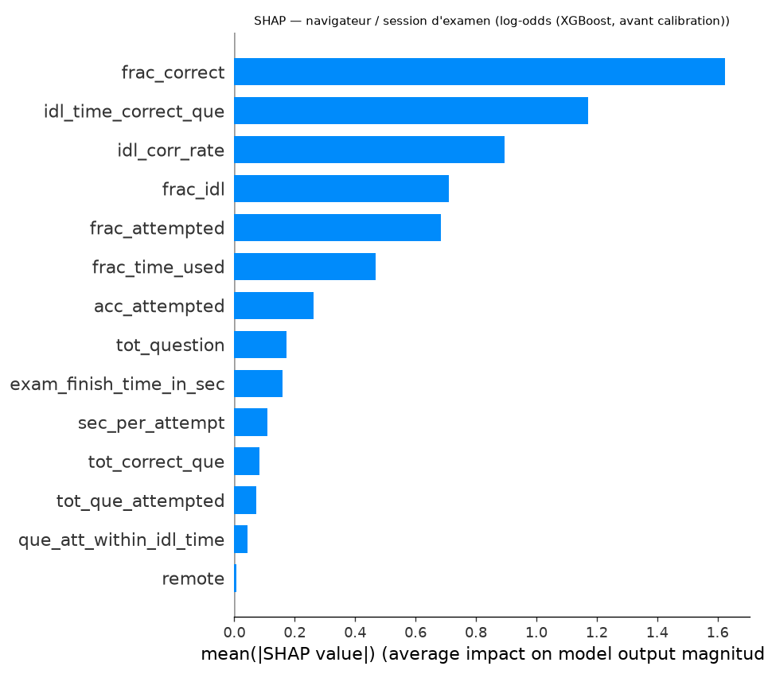
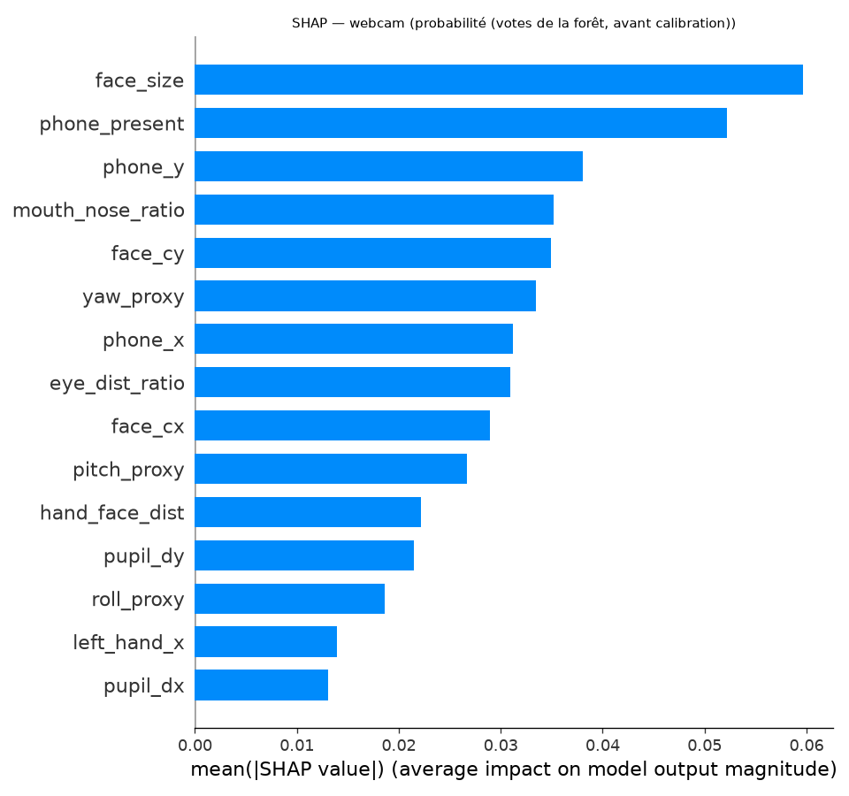

# ExamGuard AI — Rapport ML

*Généré automatiquement par `python -m examguard_ml.report` à partir des résultats réels
(graine 42). Aucun chiffre n'est saisi à la main.*

## Résumé

- **Branche B (session d'examen)** — XGBoost retenu : PR-AUC test **0.821**
  (IC 95 % [0.685 ; 0.953]), F1 0.722,
  rappel@précision≥0,8 = 0.526, sur seulement 19 cas de triche en test.
  Convention « temps idéal » retenue par l'équipe : 3 min (180 s cumulées) par question.
  ⚠ Le fichier ne contient **aucune télémétrie navigateur** (onglets, copier-coller, souris, frappe), contrairement
  au cahier des charges ; et **les 77 tricheurs ont tous réussi l'examen** (biais « bonne note = suspect »).
- **Branche A (webcam)** — Random Forest retenu, entraîné **uniquement sur des variables reproductibles dans le
  navigateur** : PR-AUC test **0.934** (IC 95 % [0.920 ; 0.947]), F1 0.847.
  Pas d'identifiant participant : découpage par blocs de 100 images contiguës ; selon la taille des blocs la PR-AUC
  de validation croisée varie de 0.896 (blocs de 500) à 0.943 (blocs de 25), et atteint
  0.960 avec un découpage aléatoire (fuite).
- **Score > 0,99 détecté et expliqué** : le modèle de référence avec toutes les colonnes Mendeley atteint
  PR-AUC 0.9998. Enquête : 0 bloc commun, 0 ligne identique train/test ; une **simple règle sans
  apprentissage** (« au moins une anomalie de détecteur ») obtient déjà F1 0.999 — l'étiquette est en grande
  partie dérivée des sorties des détecteurs (circularité), ce n'est pas une performance de détection de triche.
- **CMU Keystroke** — EER Manhattan (mis à l'échelle) 0.0962,
  Mahalanobis 0.1101 : valeurs **publiées** reproduites (0,0962 / 0,1101) ;
  écart de +0.0007 / +0.0004 avec les valeurs de l'équipe (0,0955 / 0,1097).
- **Fusion (SIMULATION, pas de jeu commun)** — poids webcam w = 0.60 choisi sur validation
  simulée ; scénario « partiel » : PR-AUC A seule 0.475,
  B seule 0.561, fusion 0.773. Illustration du mécanisme uniquement.
- **Tests** : 78 tests pytest, 0 échec(s), 0 erreur(s),
  0 ignoré(s) — durée 15 s.

## 1. Données, sources et licences

| jeu | rôle | lignes | positifs | identifiant | licence / source | utilisé |
|---|---|---|---|---|---|---|
| `online_exam_data.csv` | branche B | 1600 | 77 (4.8 %) | `student_name` unique → 1 ligne = 1 participant | fourni par l'équipe ; **source et licence non documentées**, probablement synthétique | oui |
| Mendeley 10.17632/39xs8th543.1 (Hossen & Uddin, 2025) | branche A | 5500 (76 doublons retirés) | 2619 (47.6 %) avant dédoublonnage | **aucun** → blocs contigus | CC BY 4.0 (attribution ; variables dérivées = modification) | oui |
| CMU Keystroke (Killourhy & Maxion, 2009) | identité (option) | 20400 | sans étiquette de triche | `subject` (51 sujets) | données de recherche CMU, citer l'article | oui (hors fusion) |
| Students' Abnormal Behavior (Harvard Dataverse, 10.7910/DVN/WUWRAB) | images, branche A | — | — | — | licence à vérifier | **non** (non demandé) |
| Kamalov et al. (PLOS ONE 2021) | notes | — | — | — | CC BY 4.0 | **non** (pas de télémétrie) |

Détails : [audit_browser.md](audit_browser.md), [audit_webcam.md](audit_webcam.md), [audit_keystroke.md](audit_keystroke.md).

### Constats d'audit majeurs
1. `online_exam_data.csv` ne contient que des compteurs (questions, réponses, bonnes réponses, réponses dans le
   « temps idéal ») et une durée. Trois colonnes de configuration sont parfaitement colinéaires et `result` est
   dérivé de la note : retirées. La définition du « temps idéal » n'est pas documentée dans le fichier ;
   **convention retenue par l'équipe : 3 min (180 s cumulées) par question**.
2. Les 77 cas de triche ont **tous** le résultat « pass » (0 parmi les échecs).
3. Jeu Mendeley : aucune donnée d'identité ou de session ; images successives fortement corrélées
   (distance médiane 18.4 px entre lignes consécutives contre 119.3 px au hasard).
4. Jeu Mendeley : 98.9 % des lignes « triche » présentent une anomalie de détecteur contre
   0.0 % des lignes normales → étiquette en grande partie dérivée des détecteurs.
5. Parité navigateur : 11 colonnes Mendeley exclues (scores de confiance propres à YOLO, règle main-objet maison,
   angles de tête dans une unité non documentée, modèle de regard maison) et remplacées par des variables
   géométriques calculables à l'identique à partir des points MediaPipe.

## 2. Branche B — session d'examen (`online_exam_data.csv`)

Découpage : 75 % apprentissage / 25 % test stratifié (1200 / 400 sessions, 58 / 19 triches),
une ligne = un participant (0 participant commun, 0 ligne identique). Sélection par validation croisée stratifiée
5 plis × 3 répétitions sur l'apprentissage ; seuil = F1 maximal sur les prédictions hors-échantillon ; test utilisé une seule fois.
Déséquilibre : poids de classes (`class_weight`, `scale_pos_weight`, poids d'échantillons pour le MLP) inclus dans les grilles.

| modèle | PR-AUC CV | PR-AUC test | F1 | précision | rappel | rappel@P≥0,8 | rappel@P≥0,9 | ROC-AUC | Brier | calib. |
|---|---|---|---|---|---|---|---|---|---|---|
| Régression logistique | 0.804 ± 0.077 | 0.775 | 0.789 | 0.789 | 0.789 | 0.842 | 0.474 | 0.984 | 0.018 | platt |
| Random Forest | 0.837 ± 0.091 | 0.743 | 0.778 | 0.824 | 0.737 | 0.737 | 0.000 | 0.988 | 0.018 | isotonic |
| XGBoost **(retenu)** | 0.847 ± 0.073 | 0.821 | 0.722 | 0.765 | 0.684 | 0.526 | 0.263 | 0.990 | 0.018 | platt |
| MLP (réseau de neurones) | 0.748 ± 0.092 | 0.702 | 0.645 | 0.833 | 0.526 | 0.526 | 0.000 | 0.984 | 0.021 | isotonic |

**Retenu : XGBoost** {'max_depth': 2, 'n_estimators': 200, 'balanced': False}, calibration platt, seuil 0.597.
Test : précision 0.765, rappel 0.684, taux de faux positifs 0.010 ;
matrice de confusion VN=377, FP=4, FN=6, VP=13.
IC 95 % (bootstrap stratifié) : PR-AUC [0.685 ; 0.953], F1 [0.545 ; 0.865].
Avec 19 positifs en test, les écarts entre modèles ne sont **pas significatifs** ; le choix suit la validation croisée.
ROC-AUC proche de 0,99 : attendu avec 95 % de négatifs faciles, non informatif ici (contrôles de fuite négatifs, aucune
règle triviale : un arbre de profondeur 4 laisse 32 erreurs sur tout le jeu).

Ablations (même famille de modèle, ré-optimisée) :

| variables | PR-AUC CV | PR-AUC test | rappel@P≥0,8 test |
|---|---|---|---|
| B1 complet (retenu) | 0.847 ± 0.073 | 0.821 | 0.526 |
| B2 sans « temps idéal » (parité stricte) | 0.325 ± 0.076 | 0.237 | 0.000 |
| B3 sans aucune variable de correction | 0.377 ± 0.094 | 0.339 | 0.000 |

Le modèle repose presque entièrement sur les variables « temps idéal » et sur la note : sans elles la PR-AUC
s'effondre. Ces variables sont donc **critiques** : l'application doit les calculer exactement selon la
convention retenue (temps idéal = 180 s cumulées par question), via `build_browser_features` dans `inference.py`.

  

## 3. Branche A — webcam (Mendeley), variables reproductibles uniquement

Découpage : 80 % / 20 % par **blocs de 100 lignes contiguës** (`StratifiedGroupKFold`), 4337 / 1087 images,
0 bloc commun ; validation croisée par blocs (5 plis). 5 images de test ont exactement les mêmes indicateurs
reproductibles qu'une image d'apprentissage (elles diffèrent sur les colonnes exclues).

| modèle | PR-AUC CV | PR-AUC test | F1 | précision | rappel | rappel@P≥0,8 | rappel@P≥0,9 | ROC-AUC | Brier | calib. |
|---|---|---|---|---|---|---|---|---|---|---|
| Régression logistique | 0.811 ± 0.052 | 0.770 | 0.665 | 0.756 | 0.594 | 0.541 | 0.471 | 0.734 | 0.183 | isotonic |
| Random Forest **(retenu)** | 0.921 ± 0.010 | 0.934 | 0.847 | 0.869 | 0.826 | 0.901 | 0.760 | 0.931 | 0.103 | platt |
| XGBoost | 0.923 ± 0.012 | 0.938 | 0.844 | 0.828 | 0.859 | 0.891 | 0.794 | 0.932 | 0.100 | platt |
| MLP (réseau de neurones) | 0.909 ± 0.017 | 0.908 | 0.823 | 0.812 | 0.836 | 0.846 | 0.598 | 0.908 | 0.122 | platt |

**Retenu : Random Forest** {'max_depth': None, 'min_samples_leaf': 1, 'class_weight': None}, calibration platt, seuil 0.488
(règle : meilleure PR-AUC en validation croisée sur l'apprentissage ; à moins de 0.005 du meilleur, le modèle le plus simple est préféré (logreg < RF < XGBoost < MLP). Le jeu de test n'intervient pas dans le choix.). Test : précision 0.869, rappel 0.826,
taux de faux positifs **0.108** par image ; VN=519, FP=63, FN=88, VP=417.

**Fuite temporelle mesurée** (validation croisée 5 plis sur tout le jeu, même modèle) :
découpage aléatoire des lignes → PR-AUC 0.960 ± 0.003 ; par blocs :

| taille des blocs | nb de blocs | PR-AUC CV (moy ± é.-t.) |
|---|---|---|
| 25 | 220 | 0.943 ± 0.016 |
| 100 | 55 | 0.934 ± 0.008 |
| 250 | 22 | 0.918 ± 0.016 |
| 500 | 11 | 0.896 ± 0.057 |

Plus les blocs sont petits, plus le score est optimiste : des images voisines d'une même vidéo se retrouvent des deux
côtés. Avec des blocs de 100, une fuite résiduelle est probable ; l'estimation prudente est celle des grands blocs
(≈ 0.90, très variable). Seul un identifiant de participant permettrait de conclure.

**Enquête « score > 0,99 » (modèle de référence non déployable, toutes les colonnes Mendeley)** :
PR-AUC CV 0.9993, test 0.9998. Contrôles : 0 bloc commun,
0 ligne identique entre apprentissage et test. Règle sans apprentissage
« tête non frontale OU regard décentré OU téléphone OU objet en main OU nombre de visages ≠ 1 » sur le test :
précision 1.000, rappel 0.998, F1 0.999. **Conclusion** : pas de fuite de découpage, mais une
étiquette quasi déterministe des sorties de détecteurs (circularité). Ce score ne doit pas être présenté comme une
performance de détection de triche.

Coût de la parité (même découpage) : référence 0.9998 → modèle déployable 0.9343.

   

**Deep learning** : un MLP (perceptron multicouche, poids de classes) a été entraîné pour les deux branches.
TabNet / FT-Transformer n'ont pas été entraînés : ils nécessitent PyTorch (téléchargement lourd, à valider avec vous)
et ne sont pas pertinents ici — données tabulaires de quelques milliers de lignes, où le MLP fait déjà moins bien que
les arbres, et dont l'étiquette est en grande partie une règle.

## 4. Module CMU Keystroke (optionnel, hors fusion)

Protocole Killourhy & Maxion : 51 sujets, 200 saisies d'apprentissage, 200 saisies légitimes + 250 d'imposteurs
en test par sujet ; EER par sujet (interpolation linéaire, comme le script R des auteurs) puis moyenne.

| détecteur | EER moyen | écart-type | valeur publiée | valeur équipe |
|---|---|---|---|---|
| manhattan_scaled | 0.0962 | 0.0694 | 0.0962 | 0.0955 |
| mahalanobis | 0.1101 | 0.0645 | 0.1101 | 0.1097 |

Les valeurs publiées sont reproduites à 10⁻⁴ près (écarts-types compris). Les valeurs de l'équipe (0,0955 / 0,1097)
ne sont pas retrouvées exactement : plusieurs variantes de calcul de l'EER (roc_curve + brentq, point le plus proche,
min-max) et de détecteur (écart-type, covariance régularisée) ont été testées sans les retrouver ; le script d'origine
n'était pas disponible. Écart ≤ 0,0007, très inférieur à la dispersion entre sujets (≈ 0,07). Détails : [keystroke.md](keystroke.md).

## 5. Fusion — SIMULATION (aucun jeu commun)

> Les paires (score A, score B) sont **simulées** en associant au hasard des prédictions de test des deux branches de
> même étiquette, à une prévalence de 5 %. Ce n'est **pas** une mesure de performance du système.

Les probabilités sont d'abord ramenées à la même prévalence (5 %) : A est calibrée sur 47.0 % de triche,
B sur 4.8 %. Le poids est choisi sur des paires simulées issues des prédictions hors-échantillon de
l'apprentissage, puis évalué sur des paires issues des jeux de test (200 simulations de 2000 paires).

**Scénario concordant** (la triche se voit dans les deux modalités), w* = 0.55 :

| score | PR-AUC | F1 | rappel@P≥0,8 |
|---|---|---|---|
| webcam seule (A) | 0.693 ± 0.040 | 0.610 ± 0.044 | 0.499 ± 0.072 |
| navigateur seul (B) | 0.830 ± 0.029 | 0.725 ± 0.038 | 0.614 ± 0.152 |
| fusion pondérée (w=0.55) | 0.925 ± 0.018 | 0.811 ± 0.030 | 0.863 ± 0.066 |
| fusion w=0,5 | 0.922 ± 0.018 | 0.815 ± 0.029 | 0.852 ± 0.076 |
| max(A, B) (comparaison) | 0.886 ± 0.023 | 0.794 ± 0.032 | 0.781 ± 0.091 |

**Scénario partiel** (la triche se voit dans les deux (1/3), seulement webcam (1/3) ou seulement navigateur (1/3)), w* = 0.60 — retenu pour la configuration :

| score | PR-AUC | F1 | rappel@P≥0,8 |
|---|---|---|---|
| webcam seule (A) | 0.475 ± 0.045 | 0.455 ± 0.049 | 0.306 ± 0.055 |
| navigateur seul (B) | 0.561 ± 0.047 | 0.553 ± 0.046 | 0.292 ± 0.098 |
| fusion pondérée (w=0.60) | 0.773 ± 0.037 | 0.696 ± 0.039 | 0.564 ± 0.087 |
| fusion w=0,5 | 0.763 ± 0.038 | 0.683 ± 0.041 | 0.541 ± 0.103 |
| max(A, B) (comparaison) | 0.753 ± 0.039 | 0.671 ± 0.042 | 0.522 ± 0.106 |

Configuration exportée : `artifacts/fusion_config.json` (w_webcam = 0.6, seuil 0.256).
L'indépendance supposée entre modalités favorise la fusion ; la branche B n'a que 19 positifs de test
réutilisés. Détails : [fusion.md](fusion.md).



## 6. Explicabilité (SHAP)

- Branche B — variables les plus influentes : Part de bonnes réponses (sur l'examen), Bonnes réponses données dans le temps idéal, Taux de réussite des réponses rapides (temps idéal), Part des réponses données dans le temps idéal, Part des questions répondues.
- Branche A — variables les plus influentes : Taille du visage (proximité de la caméra), Téléphone détecté (1 = oui), Téléphone : position verticale, Distance bouche-nez (tête baissée/levée), Position verticale du visage.
- `explain(branch, features, k)` renvoie les k contributions (variable, libellé, valeur, contribution, direction,
  phrase lisible) + l'avertissement « un score n'est pas une preuve ». Exemples réels (vrai positif, faux positif,
  faux négatif) : [explainability.md](explainability.md).

 

Exemple de sortie (branche B, vrai positif du test) :

```json
{
  "branche": "navigateur / session d'examen",
  "probabilite": 0.9744,
  "seuil": 0.59656,
  "alerte": true,
  "valeur_de_base": -3.02075,
  "unite_contribution": "log-odds (XGBoost, avant calibration)",
  "contributions": [
    {
      "variable": "frac_idl",
      "libelle": "Part des réponses données dans le temps idéal",
      "valeur": 0.9474,
      "contribution": 1.50944,
      "direction": "augmente le risque",
      "texte": "Part des réponses données dans le temps idéal = 0.9474 → augmente le risque"
    },
    {
      "variable": "idl_time_correct_que",
      "libelle": "Bonnes réponses données dans le temps idéal",
      "valeur": 17.0,
      "contribution": 1.37108,
      "direction": "augmente le risque",
      "texte": "Bonnes réponses données dans le temps idéal = 17 → augmente le risque"
    },
    {
      "variable": "frac_correct",
      "libelle": "Part de bonnes réponses (sur l'examen)",
      "valeur": 0.95,
      "contribution": 1.24843,
      "direction": "augmente le risque",
      "texte": "Part de bonnes réponses (sur l'examen) = 0.95 → augmente le risque"
    },
    {
      "variable": "idl_corr_rate",
      "libelle": "Taux de réussite des réponses rapides (temps idéal)",
      "valeur": 0.9444,
      "contribution": 1.07061,
      "direction": "augmente le risque",
      "texte": "Taux de réussite des réponses rapides (temps idéal) = 0.9444 → augmente le risque"
    },
    {
      "variable": "tot_question",
      "libelle": "Nombre de questions de l'examen",
      "valeur": 20.0,
      "contribution": 0.55306,
      "direction": "augmente le risque",
      "texte": "Nombre de questions de l'examen = 20 → augmente le risque"
    }
  ],
  "avertissement": "Un score n'est pas une preuve : il signale un comportement à vérifier. L'enseignant décide et l'étudiant peut contester."
}
```

## 7. Tests et qualité (Phase 7)

Dernier passage : **78 tests, 0 échec(s), 0 erreur(s), 0 ignoré(s)** en 15 s.

Couverture : schéma d'entrée (valeurs manquantes, NaN, hors plage, incohérences, champs inconnus ; toutes les lignes
d'entraînement acceptées), absence de fuite (groupes disjoints, prétraitement ajusté sur l'apprentissage seulement,
découpages reproductibles), déterminisme (même graine = mêmes prédictions), taille et latence des modèles,
stabilité (petites perturbations), reproduction des prédictions sauvegardées, contrat `inference.py`, EER CMU.
Latence médiane mesurée (CPU, une observation) : predict_browser 11.1 ms, predict_webcam 53.5 ms, explain navigateur 22 ms, explain webcam 160 ms. Taille : 0.03 Mo (B), 4.57 Mo (A).

## 8. Limites

**Biais**
- B : l'étiquette est liée à la réussite (100 % des tricheurs ont réussi) → un bon étudiant rapide sera plus souvent
  signalé. L'ablation B3 (sans note) tombe à PR-AUC 0.339 en test : la note porte une grande partie du signal.
- A : données de laboratoire, une seule configuration de caméra 640×480, population et éclairage non décrits ;
  aucune mesure possible par sous-groupe (éclairage, handicap, qualité de caméra) car ces informations n'existent pas.
  Les variables de position du visage peuvent pénaliser un étudiant qui s'installe différemment.

**Faux positifs**
- A : taux de faux positifs 0.108 **par image** au seuil retenu. À une prévalence réelle de 5 %, la précision
  attendue tomberait à ≈ 0.29 (calcul avec le même rappel et le même taux de FP) : il faut agréger sur une
  fenêtre de temps (`predict_webcam_session`) et ne jamais alerter sur une image isolée.
- B : 4 faux positifs sur 381 sessions honnêtes du test (1.0 %).

**Absence de jeu commun** : la fusion n'est évaluée que sur des paires simulées ; les poids devront être ré-estimés
sur le pilote. **Fuites évitées** : identifiants exclus, découpage par participant (B) et par blocs (A), doublons
retirés avant découpage, prétraitement et calibration ajustés uniquement sur l'apprentissage, seuils choisis hors test,
test utilisé une seule fois. **Fuite résiduelle possible** en A (pas d'identifiant de session).

**Parité** : les variables webcam supposent un repère 640×480 et les conventions MediaPipe documentées dans
[audit_webcam.md](audit_webcam.md) ; la détection de téléphone par MediaPipe ObjectDetector n'a pas le même rappel que YOLO.

## 9. Ce qui reste avant l'intégration

1. **Chronométrer chaque question côté application** (temps cumulé de toutes les visites) et calculer les compteurs
   avec `build_browser_features` — convention « temps idéal = 3 min/question » retenue par l'équipe. Si la source
   du jeu publie une autre définition, réaligner la convention ou réentraîner.
2. **Collecter des données navigateur étiquetées** (onglets, copier-coller, focus, frappe) pendant le pilote : aucune
   donnée publique ne les couvre ; d'ici là, ces événements doivent être des **règles affichées**, pas un score appris.
3. Implémenter côté navigateur l'extraction MediaPipe **exactement** selon les conventions (repère 640×480, points
   du Face Detector, iris 468/473, poignets) et vérifier la parité sur quelques vidéos du pilote (même entrée → mêmes
   variables qu'en Python).
4. Pilote 10–20 volontaires : ré-estimer le poids de fusion, le seuil et la prévalence de déploiement ; mesurer
   les faux positifs par sous-groupe.
5. Décider si TabNet / FT-Transformer valent l'ajout de PyTorch (non recommandé sur ces données).
6. Clarifier la source et la licence de `online_exam_data.csv` avant toute publication.
7. Branche images (Harvard Dataverse) + Grad-CAM : non faite (non demandée).

## 10. Récapitulatif

**Fait** : environnement reproductible (`environment.yml`) ; audits et parité ; branche B (XGBoost, PR-AUC test
0.821) ; branche A (Random Forest, PR-AUC test 0.934) ; MLP pour les deux branches ; calibration ;
module CMU (EER publiées reproduites) ; fusion pondérée avec ablation sur paires simulées ; SHAP global/local et
`explain()` JSON ; schémas pydantic ; `inference.py` ; tests pytest ; fiche modèle ; commande unique
`python -m examguard_ml.pipeline` (dernière durée : 806 s).

**Cassé / non atteint** : EER de l'équipe (0,0955 / 0,1097) non reproduites exactement (valeurs publiées reproduites). Non atteints par nature des données :
découpage par participant pour A (aucun identifiant), évaluation réelle de la fusion (aucun jeu commun), modèle
d'événements navigateur (aucune donnée étiquetée).

**Reste** : voir section 9 — en priorité le chronométrage par question selon la convention des 3 min, la collecte
de données navigateur et le pilote.
