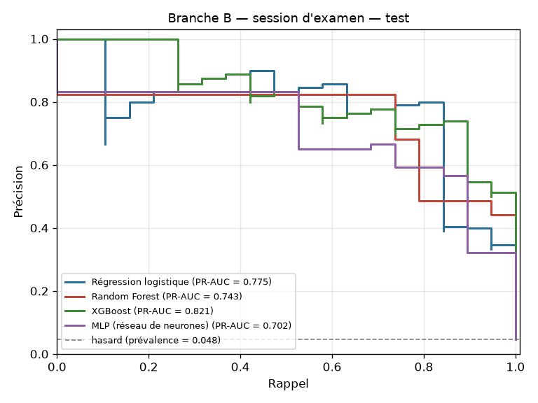
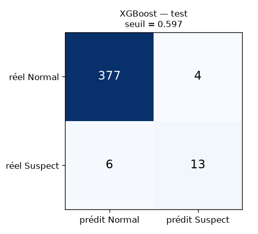
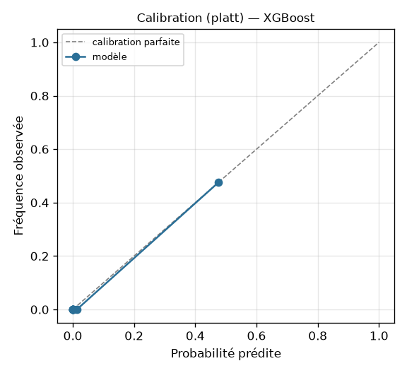

# Branche B — session d'examen (online_exam_data.csv)

Apprentissage : 1200 lignes (58 positifs) — test : 400 lignes
(19 positifs). Groupes : participant (student_name). Validation croisée : 15 plis.
Contrôle de fuite train/test : {'groupes_communs_train_test': 0, 'lignes_test_identiques_a_une_ligne_train': 0}.

## Comparaison des modèles (seuil choisi sur les prédictions hors-échantillon de l'apprentissage)

| modèle | PR-AUC CV (moy ± é.-t.) | PR-AUC test | ROC-AUC test | F1 test | précision | rappel | rappel@P≥0,8 | rappel@P≥0,9 | Brier | calibration | seuil |
|---|---|---|---|---|---|---|---|---|---|---|---|
| Régression logistique | 0.804 ± 0.077 | 0.775 | 0.984 | 0.789 | 0.789 | 0.789 | 0.842 | 0.474 | 0.018 | platt | 0.387 |
| Random Forest | 0.837 ± 0.091 | 0.743 | 0.988 | 0.778 | 0.824 | 0.737 | 0.737 | 0.000 | 0.018 | isotonic | 0.960 |
| XGBoost ✔ | 0.847 ± 0.073 | 0.821 | 0.990 | 0.722 | 0.765 | 0.684 | 0.526 | 0.263 | 0.018 | platt | 0.597 |
| MLP (réseau de neurones) | 0.748 ± 0.092 | 0.702 | 0.984 | 0.645 | 0.833 | 0.526 | 0.526 | 0.000 | 0.021 | isotonic | 0.653 |

**Modèle retenu : XGBoost** — paramètres {'max_depth': 2, 'n_estimators': 200, 'balanced': False}, calibration platt,
seuil 0.597. Règle de sélection : meilleure PR-AUC en validation croisée sur l'apprentissage ; à moins de 0.005 du meilleur, le modèle le plus simple est préféré (logreg < RF < XGBoost < MLP). Le jeu de test n'intervient pas dans le choix.

Test : PR-AUC 0.821, F1 0.722, précision 0.765, rappel 0.684,
taux de faux positifs 0.010. IC 95 % bootstrap : PR-AUC [0.685 ; 0.953], F1 [0.545 ; 0.865]

Matrice de confusion (test) : VN=377, FP=4, FN=6, VP=13.

Alertes de score > 0,99 : aucune.

