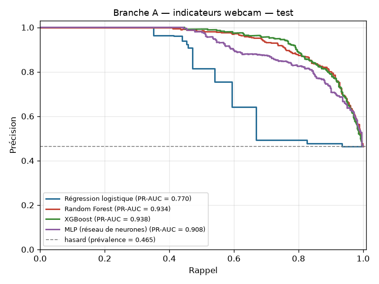
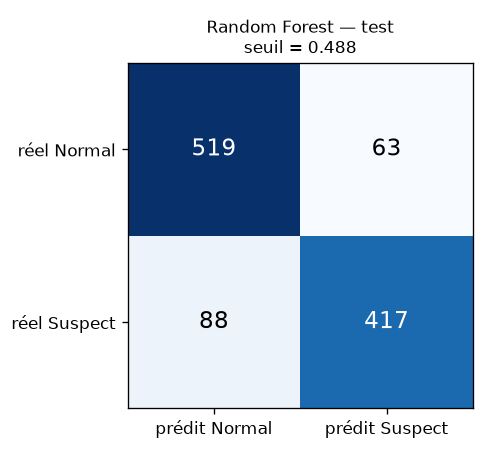
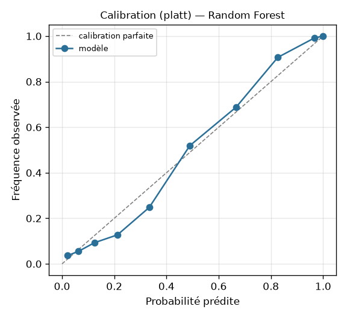

# Branche A — indicateurs webcam (Mendeley 10.17632/39xs8th543.1)

Apprentissage : 4337 lignes (2038 positifs) — test : 1087 lignes
(505 positifs). Groupes : bloc de 100 lignes contigues. Validation croisée : 5 plis.
Contrôle de fuite train/test : {'groupes_communs_train_test': 0, 'lignes_test_identiques_a_une_ligne_train': 5}.

## Comparaison des modèles (seuil choisi sur les prédictions hors-échantillon de l'apprentissage)

| modèle | PR-AUC CV (moy ± é.-t.) | PR-AUC test | ROC-AUC test | F1 test | précision | rappel | rappel@P≥0,8 | rappel@P≥0,9 | Brier | calibration | seuil |
|---|---|---|---|---|---|---|---|---|---|---|---|
| Régression logistique | 0.811 ± 0.052 | 0.770 | 0.734 | 0.665 | 0.756 | 0.594 | 0.541 | 0.471 | 0.183 | isotonic | 0.414 |
| Random Forest ✔ | 0.921 ± 0.010 | 0.934 | 0.931 | 0.847 | 0.869 | 0.826 | 0.901 | 0.760 | 0.103 | platt | 0.488 |
| XGBoost | 0.923 ± 0.012 | 0.938 | 0.932 | 0.844 | 0.828 | 0.859 | 0.891 | 0.794 | 0.100 | platt | 0.398 |
| MLP (réseau de neurones) | 0.909 ± 0.017 | 0.908 | 0.908 | 0.823 | 0.812 | 0.836 | 0.846 | 0.598 | 0.122 | platt | 0.455 |

**Modèle retenu : Random Forest** — paramètres {'max_depth': None, 'min_samples_leaf': 1, 'class_weight': None}, calibration platt,
seuil 0.488. Règle de sélection : meilleure PR-AUC en validation croisée sur l'apprentissage ; à moins de 0.005 du meilleur, le modèle le plus simple est préféré (logreg < RF < XGBoost < MLP). Le jeu de test n'intervient pas dans le choix.

Test : PR-AUC 0.934, F1 0.847, précision 0.869, rappel 0.826,
taux de faux positifs 0.108. IC 95 % bootstrap : PR-AUC [0.920 ; 0.947], F1 [0.823 ; 0.870]

Matrice de confusion (test) : VN=519, FP=63, FN=88, VP=417.

Alertes de score > 0,99 : aucune.

