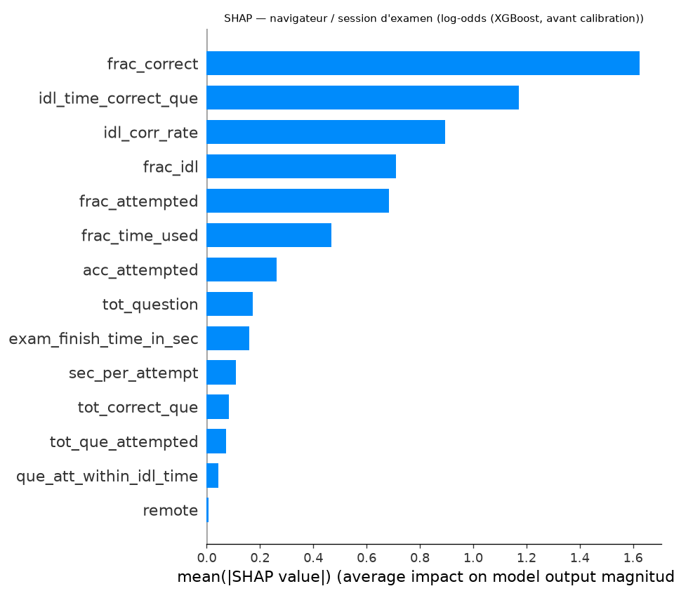
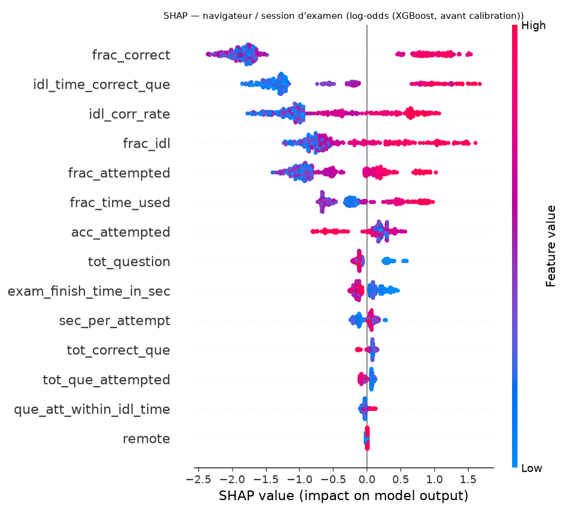
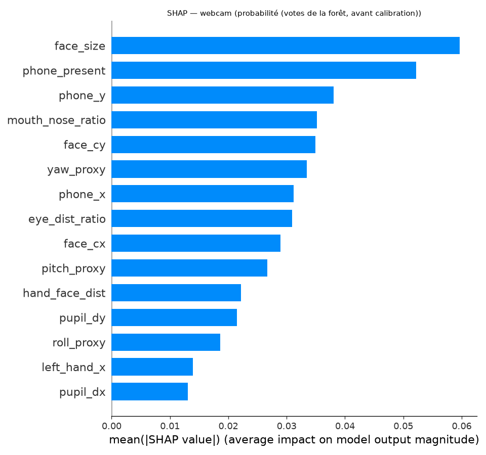
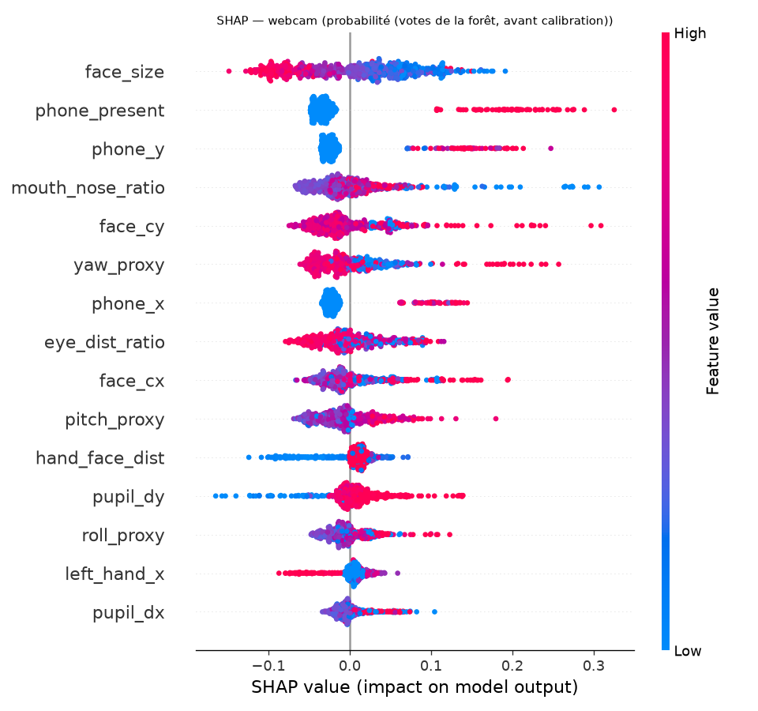

# Explicabilité (SHAP)

Contributions calculées sur le modèle **avant calibration** (la calibration est monotone : le sens des contributions est conservé). Global = moyenne des |SHAP| sur le jeu de test.

## Branche navigateur / session d'examen — XGBoost

| variable | libellé | importance moyenne \|SHAP\| |
|---|---|---|
| frac_correct | Part de bonnes réponses (sur l'examen) | 1.6252 |
| idl_time_correct_que | Bonnes réponses données dans le temps idéal | 1.1710 |
| idl_corr_rate | Taux de réussite des réponses rapides (temps idéal) | 0.8947 |
| frac_idl | Part des réponses données dans le temps idéal | 0.7095 |
| frac_attempted | Part des questions répondues | 0.6836 |
| frac_time_used | Part du temps alloué utilisée | 0.4674 |
| acc_attempted | Taux de réussite sur les questions répondues | 0.2634 |
| tot_question | Nombre de questions de l'examen | 0.1714 |
| exam_finish_time_in_sec | Durée de la session (secondes) | 0.1589 |
| sec_per_attempt | Temps moyen par question répondue (s) | 0.1086 |
| tot_correct_que | Nombre de bonnes réponses | 0.0823 |
| tot_que_attempted | Nombre de questions répondues | 0.0713 |




**Exemple — vrai positif** : probabilité 0.974 (seuil 0.597)
  - Part des réponses données dans le temps idéal = 0.9474 → augmente le risque (contribution +1.509)
  - Bonnes réponses données dans le temps idéal = 17 → augmente le risque (contribution +1.371)
  - Part de bonnes réponses (sur l'examen) = 0.95 → augmente le risque (contribution +1.248)
  - Taux de réussite des réponses rapides (temps idéal) = 0.9444 → augmente le risque (contribution +1.071)
  - Nombre de questions de l'examen = 20 → augmente le risque (contribution +0.553)

**Exemple — faux positif** : probabilité 0.908 (seuil 0.597)
  - Bonnes réponses données dans le temps idéal = 29 → augmente le risque (contribution +1.611)
  - Part de bonnes réponses (sur l'examen) = 0.78 → augmente le risque (contribution +1.194)
  - Part des questions répondues = 1 → augmente le risque (contribution +0.941)
  - Part du temps alloué utilisée = 0.9896 → augmente le risque (contribution +0.867)
  - Taux de réussite des réponses rapides (temps idéal) = 1 → augmente le risque (contribution +0.852)

**Exemple — faux négatif** : probabilité 0.061 (seuil 0.597)
  - Part de bonnes réponses (sur l'examen) = 0.6 → augmente le risque (contribution +0.686)
  - Part du temps alloué utilisée = 0.6136 → diminue le risque (contribution -0.641)
  - Taux de réussite des réponses rapides (temps idéal) = 0.5714 → diminue le risque (contribution -0.389)
  - Nombre de questions de l'examen = 20 → augmente le risque (contribution +0.351)
  - Taux de réussite sur les questions répondues = 0.6316 → augmente le risque (contribution +0.282)

## Branche webcam — Random Forest

| variable | libellé | importance moyenne \|SHAP\| |
|---|---|---|
| face_size | Taille du visage (proximité de la caméra) | 0.0596 |
| phone_present | Téléphone détecté (1 = oui) | 0.0522 |
| phone_y | Téléphone : position verticale | 0.0381 |
| mouth_nose_ratio | Distance bouche-nez (tête baissée/levée) | 0.0352 |
| face_cy | Position verticale du visage | 0.0350 |
| yaw_proxy | Rotation de la tête gauche/droite | 0.0334 |
| phone_x | Téléphone : position horizontale | 0.0312 |
| eye_dist_ratio | Écart des yeux / largeur du visage (rotation de la tête) | 0.0310 |
| face_cx | Position horizontale du visage | 0.0289 |
| pitch_proxy | Inclinaison de la tête haut/bas | 0.0267 |
| hand_face_dist | Distance main-visage | 0.0222 |
| pupil_dy | Regard : décalage vertical des pupilles | 0.0215 |




**Exemple — vrai positif** : probabilité 1.000 (seuil 0.488)
  - Distance bouche-nez (tête baissée/levée) = 0 → augmente le risque (contribution +0.129)
  - Taille du visage (proximité de la caméra) = 0 → augmente le risque (contribution +0.114)
  - Position horizontale du visage = 0 → augmente le risque (contribution +0.107)
  - Écart des yeux / largeur du visage (rotation de la tête) = 0 → augmente le risque (contribution +0.090)
  - Position verticale du visage = 0 → augmente le risque (contribution +0.050)

**Exemple — faux positif** : probabilité 0.914 (seuil 0.488)
  - Taille du visage (proximité de la caméra) = 0.1934 → augmente le risque (contribution +0.139)
  - Écart des yeux / largeur du visage (rotation de la tête) = 0.3422 → augmente le risque (contribution +0.116)
  - Rotation de la tête gauche/droite = -0.434 → augmente le risque (contribution +0.058)
  - Distance bouche-nez (tête baissée/levée) = 0.6703 → augmente le risque (contribution +0.032)
  - Regard : décalage vertical des pupilles = 0 → augmente le risque (contribution +0.028)

**Exemple — faux négatif** : probabilité 0.002 (seuil 0.488)
  - Taille du visage (proximité de la caméra) = 0.2907 → diminue le risque (contribution -0.062)
  - Main gauche : position horizontale = 0.4198 → diminue le risque (contribution -0.046)
  - Distance main-visage = 0.2348 → diminue le risque (contribution -0.042)
  - Regard : décalage vertical des pupilles = -1.4114 → diminue le risque (contribution -0.040)
  - Téléphone détecté (1 = oui) = 0 → diminue le risque (contribution -0.037)


Format JSON renvoyé par `explain()` (exemple réel) :

```json
{
  "branche": "navigateur / session d'examen",
  "probabilite": 0.9744,
  "seuil": 0.59656,
  "alerte": true,
  "valeur_de_base": -3.02075,
  "unite_contribution": "log-odds (XGBoost, avant calibration)",
  "contributions": [
    {
      "variable": "frac_idl",
      "libelle": "Part des réponses données dans le temps idéal",
      "valeur": 0.9474,
      "contribution": 1.50944,
      "direction": "augmente le risque",
      "texte": "Part des réponses données dans le temps idéal = 0.9474 → augmente le risque"
    },
    {
      "variable": "idl_time_correct_que",
      "libelle": "Bonnes réponses données dans le temps idéal",
      "valeur": 17.0,
      "contribution": 1.37108,
      "direction": "augmente le risque",
      "texte": "Bonnes réponses données dans le temps idéal = 17 → augmente le risque"
    },
    {
      "variable": "frac_correct",
      "libelle": "Part de bonnes réponses (sur l'examen)",
      "valeur": 0.95,
      "contribution": 1.24843,
      "direction": "augmente le risque",
      "texte": "Part de bonnes réponses (sur l'examen) = 0.95 → augmente le risque"
    },
    {
      "variable": "idl_corr_rate",
      "libelle": "Taux de réussite des réponses rapides (temps idéal)",
      "valeur": 0.9444,
      "contribution": 1.07061,
      "direction": "augmente le risque",
      "texte": "Taux de réussite des réponses rapides (temps idéal) = 0.9444 → augmente le risque"
    },
    {
      "variable": "tot_question",
      "libelle": "Nombre de questions de l'examen",
      "valeur": 20.0,
      "contribution": 0.55306,
      "direction": "augmente le risque",
      "texte": "Nombre de questions de l'examen = 20 → augmente le risque"
    }
  ],
  "avertissement": "Un score n'est pas une preuve : il signale un comportement à vérifier. L'enseignant décide et l'étudiant peut contester."
}
```
