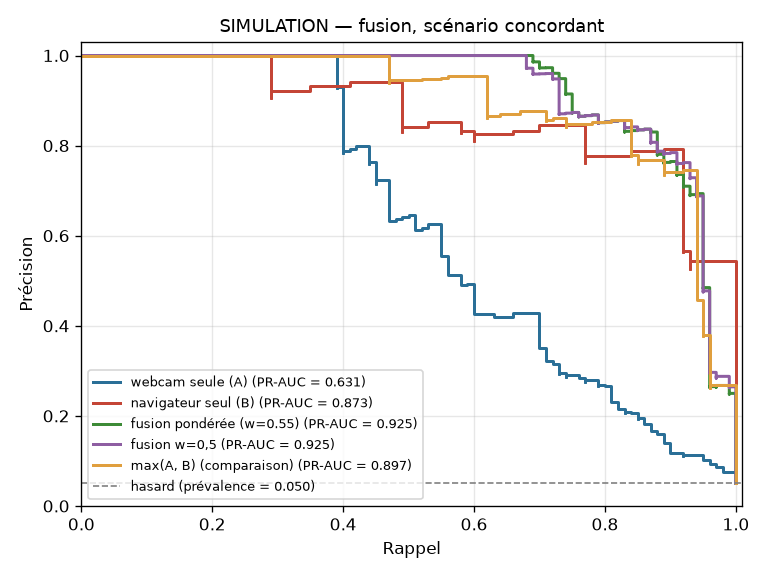
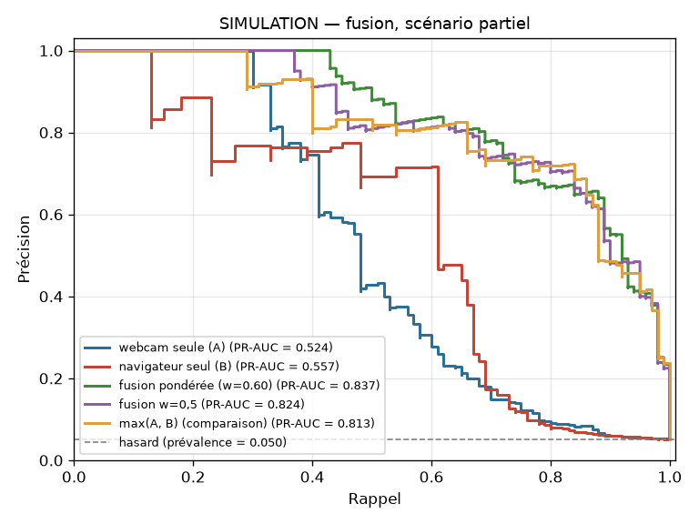

# Fusion des branches A et B — **SIMULATION**

> **Avertissement.** Aucun jeu de données public ne contient, pour les mêmes sessions, des indicateurs
> webcam ET des données de session/navigateur. Les paires ci-dessous sont **simulées** : on associe au hasard
> une prédiction de test de la branche A et une prédiction de test de la branche B de même étiquette
> (indépendance conditionnelle supposée), à une prévalence de 5%.
> Ces chiffres servent à **choisir et vérifier le mécanisme de fusion**, pas à annoncer une performance.
> Les poids devront être ré-estimés sur le pilote (10–20 volontaires, scénarios scriptés).

- Avant fusion, chaque probabilité calibrée est **ramenée à la même prévalence** (5%) :
  la branche A est calibrée sur un jeu à 47.0% de triche, la branche B à 4.8%.
- Poids choisi sur des paires simulées à partir des prédictions **hors-échantillon de l'apprentissage**
  (50 simulations), évalué sur des paires simulées à partir des **jeux de test** (200 simulations
  de 2000 paires). Seuils choisis sur la validation simulée.
- Taille des réservoirs de test : {'A1': 505, 'A0': 582, 'B1': 19, 'B0': 381} — la branche B n'a que 19 positifs de test,
  réutilisés de nombreuses fois : la variabilité réelle est sous-estimée.

## Scénario « concordant » : la triche se voit dans les deux modalités

Poids optimal sur validation simulée : **w = 0.55** (webcam) / 0.45 (navigateur).

| score | PR-AUC (moy ± é.-t.) | F1 | précision | rappel | rappel@P≥0,8 |
|---|---|---|---|---|---|
| webcam seule (A) | 0.693 ± 0.040 | 0.610 ± 0.044 | 0.795 | 0.497 | 0.499 ± 0.072 |
| navigateur seul (B) | 0.830 ± 0.029 | 0.725 ± 0.038 | 0.776 | 0.682 | 0.614 ± 0.152 |
| fusion pondérée (w=0.55) | 0.925 ± 0.018 | 0.811 ± 0.030 | 0.822 | 0.801 | 0.863 ± 0.066 |
| fusion w=0,5 | 0.922 ± 0.018 | 0.815 ± 0.029 | 0.807 | 0.825 | 0.852 ± 0.076 |
| max(A, B) (comparaison) | 0.886 ± 0.023 | 0.794 ± 0.032 | 0.800 | 0.789 | 0.781 ± 0.091 |

PR-AUC de validation selon w

| w (poids webcam) | PR-AUC validation simulée |
|---|---|
| 0.000 | 0.853 |
| 0.050 | 0.864 |
| 0.100 | 0.873 |
| 0.150 | 0.882 |
| 0.200 | 0.890 |
| 0.250 | 0.899 |
| 0.300 | 0.907 |
| 0.350 | 0.915 |
| 0.400 | 0.921 |
| 0.450 | 0.925 |
| 0.500 | 0.927 |
| 0.550 | 0.928 |
| 0.600 | 0.928 |
| 0.650 | 0.925 |
| 0.700 | 0.919 |
| 0.750 | 0.901 |
| 0.800 | 0.873 |
| 0.850 | 0.830 |
| 0.900 | 0.776 |
| 0.950 | 0.716 |
| 1.000 | 0.654 |

## Scénario « partiel » : la triche se voit dans les deux (1/3), seulement webcam (1/3) ou seulement navigateur (1/3)

Poids optimal sur validation simulée : **w = 0.60** (webcam) / 0.40 (navigateur).

| score | PR-AUC (moy ± é.-t.) | F1 | précision | rappel | rappel@P≥0,8 |
|---|---|---|---|---|---|
| webcam seule (A) | 0.475 ± 0.045 | 0.455 ± 0.049 | 0.723 | 0.333 | 0.306 ± 0.055 |
| navigateur seul (B) | 0.561 ± 0.047 | 0.553 ± 0.046 | 0.696 | 0.460 | 0.292 ± 0.098 |
| fusion pondérée (w=0.60) | 0.773 ± 0.037 | 0.696 ± 0.039 | 0.758 | 0.646 | 0.564 ± 0.087 |
| fusion w=0,5 | 0.763 ± 0.038 | 0.683 ± 0.041 | 0.755 | 0.625 | 0.541 ± 0.103 |
| max(A, B) (comparaison) | 0.753 ± 0.039 | 0.671 ± 0.042 | 0.751 | 0.608 | 0.522 ± 0.106 |

PR-AUC de validation selon w

| w (poids webcam) | PR-AUC validation simulée |
|---|---|
| 0.000 | 0.583 |
| 0.050 | 0.639 |
| 0.100 | 0.656 |
| 0.150 | 0.670 |
| 0.200 | 0.683 |
| 0.250 | 0.696 |
| 0.300 | 0.712 |
| 0.350 | 0.725 |
| 0.400 | 0.746 |
| 0.450 | 0.758 |
| 0.500 | 0.763 |
| 0.550 | 0.766 |
| 0.600 | 0.767 |
| 0.650 | 0.764 |
| 0.700 | 0.750 |
| 0.750 | 0.722 |
| 0.800 | 0.681 |
| 0.850 | 0.622 |
| 0.900 | 0.563 |
| 0.950 | 0.503 |
| 1.000 | 0.446 |

## Configuration exportée (`artifacts/fusion_config.json`)

w_webcam = 0.6, w_navigateur = 0.4, prévalence de déploiement = 0.05,
seuil d'alerte sur le score fusionné = 0.256 (choisi sur validation simulée, scénario partiel).
Source : SIMULATION (paires artificielles) — à recalibrer sur le pilote.

La ligne « max(A, B) » n'est **pas** la règle validée (moyenne pondérée) : elle est donnée à titre de comparaison,
car une moyenne dilue un signal fort présent dans une seule modalité.
